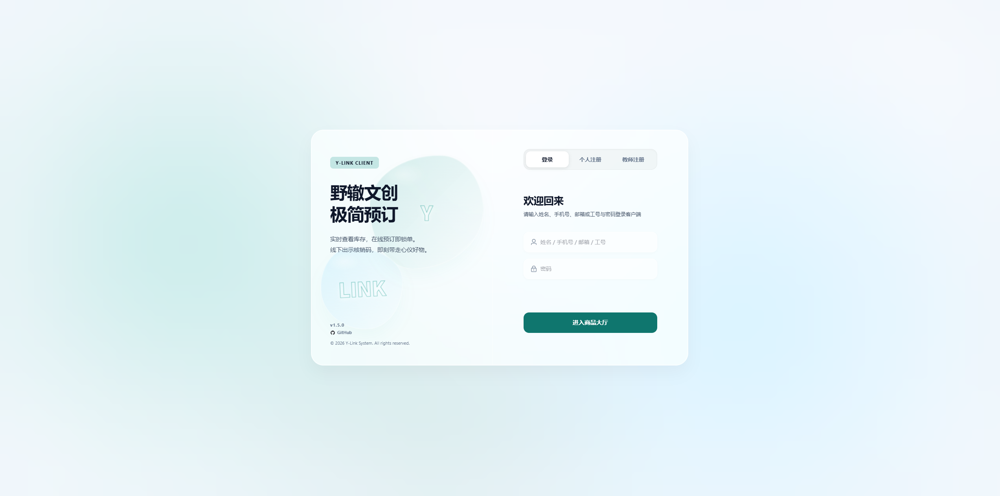
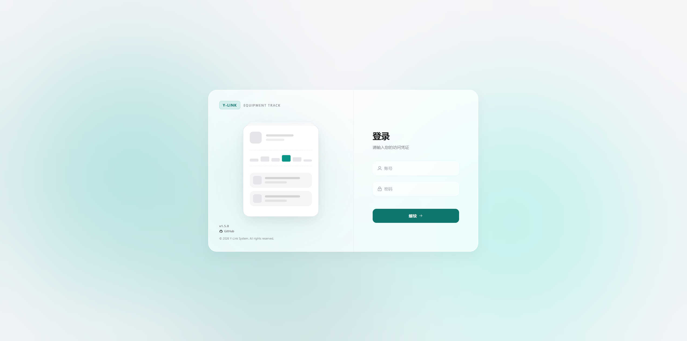
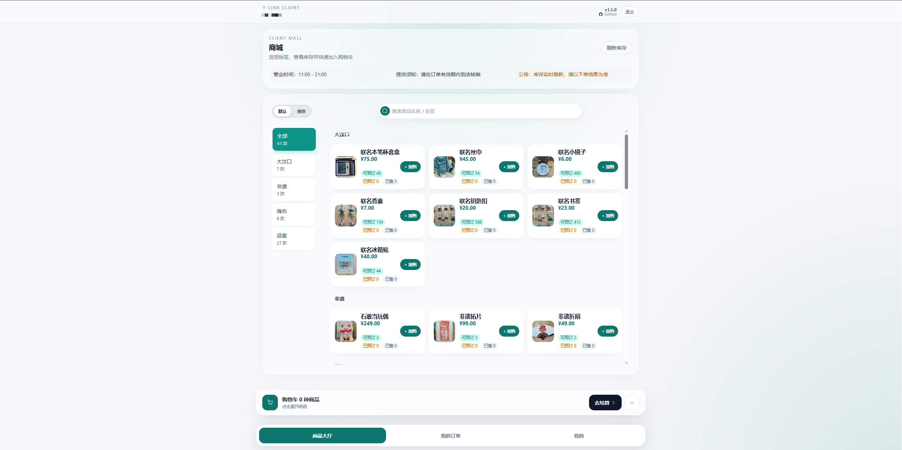
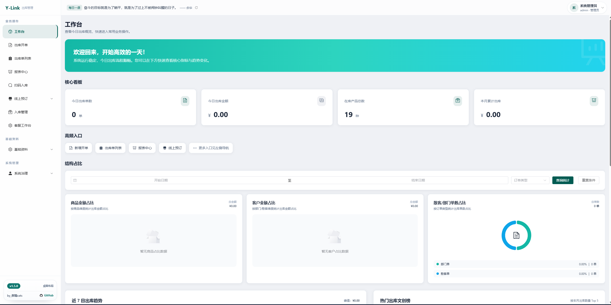
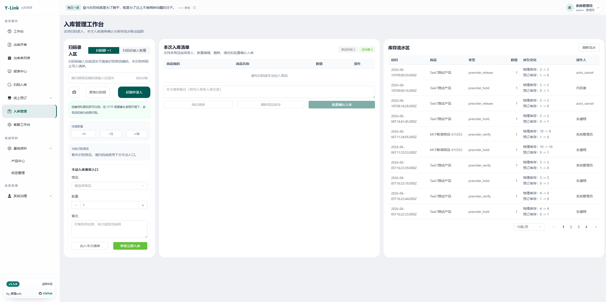
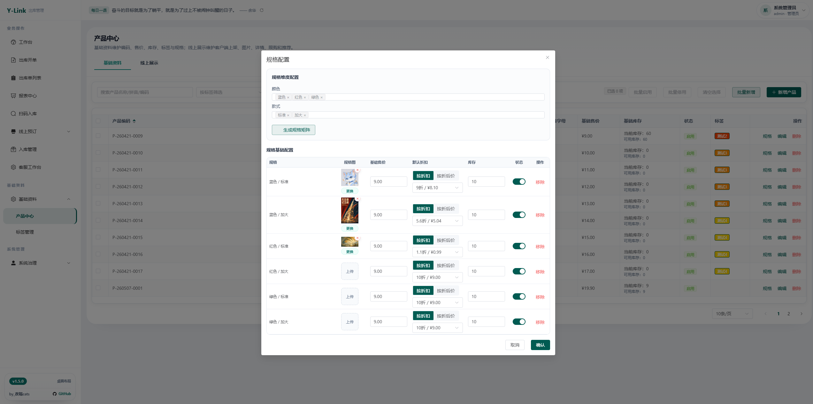
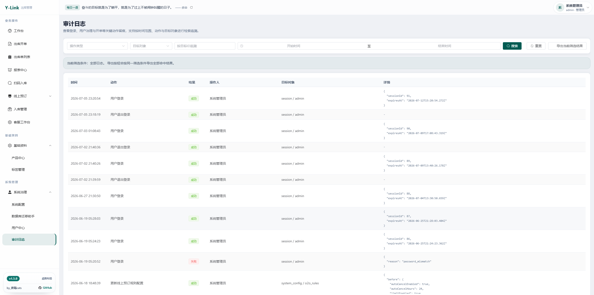
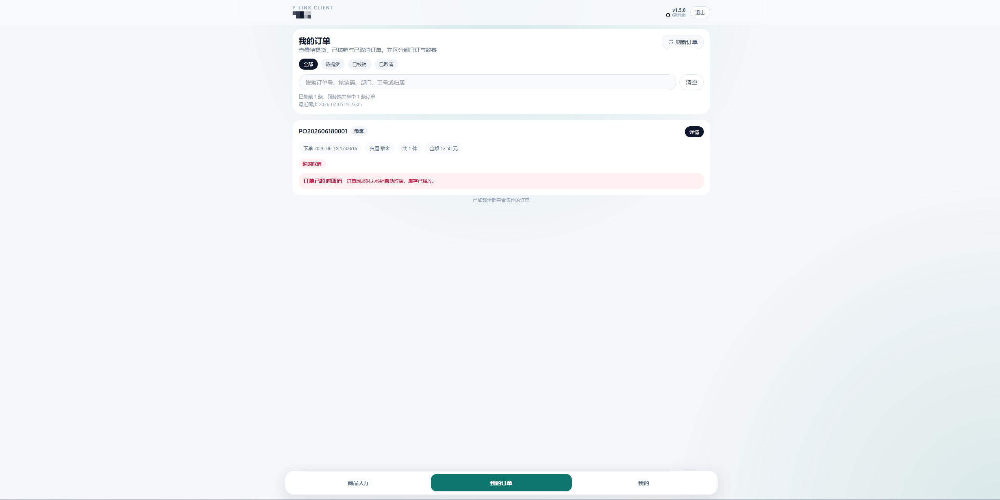
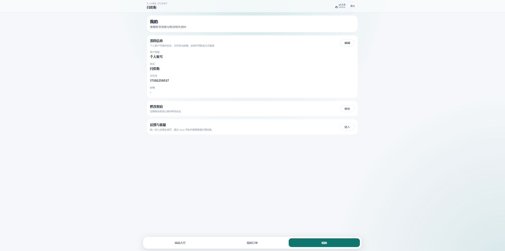

<div align="center">


# Y-Link

**文创出入库与 O2O 预订系统**

面向文创、非遗、门店与活动场景的一体化库存管理平台


[](./LICENSE)

[界面预览](#界面预览) · [功能概览](#功能概览) · [使用说明书](#使用说明书) · [快速部署](#推荐部署1panel-单镜像) · [本地开发](#本地开发) · [更新日志](./docs/版本发布历史与更新日志.md) · [使用指南](./docs/Y-Link使用指南.md) · [GitHub Wiki](https://github.com/HF-CYGG/Y-Link/wiki)

</div>

---

Y-Link 覆盖“线上预订、线下核销、出库开单、供货入库、库存追踪、客户反馈”完整流程，包含管理端与客户端两端：

- 管理端：管理员、运营人员、供货方使用，负责商品、库存、出入库、核销、用户、配置和审计。
- 客户端：普通用户使用，负责注册登录、商品大厅、购物车、预订下单、订单查看、个人资料和反馈。

技术栈：Vue 3、TypeScript、Element Plus、Pinia、Express、TypeORM。默认使用 SQLite，支持迁移到 MySQL；高并发或多实例部署可选接入独立 Redis。

## 界面预览

### 登录页面

<table>
  <tr>
    <th width="50%">图 1：用户端登录页面</th>
    <th width="50%">图 2：管理端登录页面</th>
  </tr>
  <tr>
    <td></td>
    <td></td>
  </tr>
</table>

### 主页面

<table>
  <tr>
    <th width="50%">图 3：用户端主页面</th>
    <th width="50%">图 4：管理端主页面</th>
  </tr>
  <tr>
    <td></td>
    <td></td>
  </tr>
</table>

### 管理端部分页面预览

<table>
  <tr>
    <th width="33.33%">图 5：入库管理工作台</th>
    <th width="33.33%">图 6：产品规格配置</th>
    <th width="33.33%">图 7：审计日志</th>
  </tr>
  <tr>
    <td></td>
    <td></td>
    <td></td>
  </tr>
</table>

### 用户端部分页面预览

<table>
  <tr>
    <th width="50%">图 8：我的订单</th>
    <th width="50%">图 9：我的资料</th>
  </tr>
  <tr>
    <td></td>
    <td></td>
  </tr>
</table>

## 功能概览

### 管理端

- 工作台：业务数据看板、快捷入口。
- 出库开单：商品搜索、数量录入、金额计算、单据生成。
- 出库列表：历史单据、详情、导出、作废和删除治理。
- 入库管理：供货方送货单、扫码入库、入库核销。
- 商品管理：基础资料、标签、库存、线上展示、图片。
- O2O 核销：客户预订单查询、核销、撤回和库存流水。
- 用户中心：管理端用户、供货方用户、客户端用户。
- 系统配置：验证码、部门、客户服务、业务规则等配置。
- 审计日志：登录、权限拦截、关键业务操作追踪。

### 客户端

- 注册登录：用户名、手机号、邮箱等账号能力。
- 商品大厅：商品浏览、搜索、分类、加购。
- 购物车和结算：预订下单、库存占用、订单生成。
- 我的订单：订单列表、详情、状态查看、撤回。
- 我的：资料维护、修改密码、反馈与客服入口。

### 供货方

- 独立账号登录。
- 录入送货单。
- 查看历史送货单。
- 配合管理端完成入库核销。

## 使用说明书

面向不同使用者提供图文版 Word 说明书，点击文件名即可在 GitHub 上下载：

| 使用对象 | 说明书 | 适用场景 |
| --- | --- | --- |
| 管理端 | [Y-Link 管理端使用指南](./docs/使用说明书/Y-Link管理端使用指南.docx) | 按实际界面截图说明的完整操作手册，面向具备相应权限的管理端人员（适用版本 v1.5.65.0） |
| 管理端 | [Y-Link 管理端使用指南（精简版）](./docs/使用说明书/Y-Link管理端使用指南-精简版.docx) | 精简版，便于快速上手与日常查阅（适用版本 v1.5.65.0） |
| 客户端 | [Y-Link 客户端使用指南（个人）](./docs/使用说明书/Y-Link客户端使用指南-个人.docx) | 学生、教师个人账户的注册登录、选购商品与下单流程 |
| 客户端 | [Y-Link 客户端使用指南（部门）](./docs/使用说明书/Y-Link客户端使用指南-部门.docx) | 部门账户的登录、选购商品与下单流程 |

如需在线阅读或随代码一起维护，也可查看 Markdown 版：[管理端快速上手手册](./docs/Y-Link管理端快速上手手册.md)、[客户端快速上手手册](./docs/Y-Link客户端快速上手手册.md)。

## 推荐部署：1Panel 单镜像

新手优先使用 onebox 单镜像。它把前端、后端、Nginx 放在同一个容器里，1Panel 只需要创建一个容器。

部署前先准备：

- 一个可访问的服务器端口，例如 `9050`。
- 一个初始管理员强密码，用于 `INIT_ADMIN_PASSWORD`。
- 两个宿主机目录，用于保存数据库和上传文件。

推荐目录：

```text
/opt/1panel/apps/y-link/data
/opt/1panel/apps/y-link/uploads
```

这两个目录建议纳入日常备份。

### 1. 基本信息

| 项目 | 填写 |
| --- | --- |
| 名称 | `y-link` |
| 镜像 | `ghcr.io/hf-cygg/y-link-onebox:latest` |
| 备用镜像 | `docker.io/yemiao351/y-link-onebox:latest` |
| 网络 | `bridge` |
| Entrypoint | `/entrypoint.sh` |
| Command | 留空 |

如果服务器拉取 GitHub Container Registry 慢，可改用 Docker Hub 镜像。

1Panel 操作路径通常是：容器 -> 创建容器 -> 手动输入镜像或选择已有镜像。创建时不要勾选“强制拉取镜像”，除非你明确需要重新拉取最新镜像。

### 2. 端口

| 服务器端口 | 容器端口 | 协议 | 说明 |
| --- | --- | --- | --- |
| `9050` | `80` | `tcp` | Web 访问入口 |

启动后访问：

- 管理端：`http://服务器IP:9050/login`
- 客户端：`http://服务器IP:9050/client/login`
- 健康检查：`http://服务器IP:9050/health`

如果你使用域名和 HTTPS，在 1Panel 反向代理里把域名代理到 `http://127.0.0.1:9050`。

端口说明：

- 容器内固定使用 `80` 作为 Web 入口。
- 服务器端口可以自定义，截图里的 `9050 -> 80` 是推荐写法。
- 不需要额外暴露后端 `3001`，前端、API、上传文件、健康检查都会由容器内 Nginx 统一代理。

### 3. 挂载目录

必须挂载数据目录和上传目录，否则重建容器后会丢失数据或图片。

| 本机目录 | 容器目录 | 权限 | 保存内容 |
| --- | --- | --- | --- |
| `/opt/1panel/apps/y-link/data` | `/app/data` | 读写 | SQLite 数据库 |
| `/opt/1panel/apps/y-link/uploads` | `/app/uploads` | 读写 | 商品图片、反馈附件等上传文件 |

你截图里的挂载方式是正确的：类型选“本机目录”，权限选“读写”。本机目录可以按自己的 1Panel 习惯调整，但容器目录必须保持上表一致。

目录用途：

- `/app/data/y-link.sqlite` 是默认 SQLite 数据库文件。
- `/app/uploads` 保存商品图片、反馈图片、附件等上传内容。
- 迁移服务器时，复制宿主机的 `data` 和 `uploads` 两个目录即可保留业务数据。

不要把这两个目录挂载到 `/tmp` 这类临时目录。

### 4. 环境变量

首次部署至少填写下面几项（1Panel 在容器“环境变量”页逐项新增；`docker run` 用 `-e` 传入；Compose 写入不提交到仓库的私有 `.env`）：

```env
INIT_ADMIN_PASSWORD=请改成你自己的强密码
TZ=Asia/Shanghai
# 建议配置：永久删除订单/送货单时的二次门禁密码。
PERMANENT_DELETE_PASSWORD=请改成仅管理员知晓的删除密码
```

- `INIT_ADMIN_PASSWORD` 不填容器会拒绝启动，不能使用 `Admin@123456`，建议至少 8 位并包含字母和数字；只在部署平台的环境变量里填写，不要写进公开文档或提交到仓库。
- 首次启动会用它自动创建管理员账号；已有管理员时不会覆盖原密码。日志显示 `initialized=false` 表示库里已有管理员，属于正常情况。
- 修改环境变量后需要**重新创建容器**才会生效，普通 `docker restart` 不会更新容器环境。

下面两张表列出全部可配置的环境变量。

#### 必须配置

| 变量 | 何时必须 | 说明 |
| --- | --- | --- |
| `INIT_ADMIN_PASSWORD` | 始终 | 初始管理员密码，要求见上文 |
| `DB_HOST`、`DB_PORT`、`DB_USER`、`DB_PASSWORD`、`DB_NAME` | `DB_TYPE=mysql` | 外置 MySQL 的地址、端口（默认 `3306`）、账号、密码与库名（默认 `y_link`），库字符集使用 `utf8mb4` |
| `INVITE_CODE_PEPPER` | 启用教师统一邀请码 | 邀请码 HMAC 密钥，至少 32 个随机字节 |
| `ALIBABA_CLOUD_ACCESS_KEY_ID`、`ALIBABA_CLOUD_ACCESS_KEY_SECRET` | 短信通道使用阿里云 PNVS | RAM 用户的 AccessKey，见[阿里云 PNVS 短信验证码](#10-可选阿里云-pnvs-短信验证码) |
| `VERIFICATION_TICKET_HMAC_SECRET` | 短信通道使用阿里云 PNVS | 关联手机号与受理记录的 HMAC 密钥，至少 32 个随机字节 |
| `AUTH_WEBAUTHN_RP_ID`、`AUTH_WEBAUTHN_RP_NAME`、`AUTH_WEBAUTHN_ORIGINS` | `AUTH_WEBAUTHN_ENABLED=true` | 浏览器访问域名、展示名称与外部访问地址 JSON 数组，见[管理端通行密钥与安全密钥](#11-可选管理端通行密钥与安全密钥) |
| `REDIS_URL` | `Y_LINK_MULTI_INSTANCE=true` | 独立 Redis 地址，见[Redis 与多实例部署](#redis-与多实例部署可选) |
| `Y_LINK_DATA_ENCRYPTION_KEY` | `Y_LINK_MULTI_INSTANCE=true`；或数据库中已有加密配置、但数据目录丢失 `secrets/data-encryption.key` | 敏感配置与安全票据的加密主密钥，32 字节（base64 或 64 位十六进制），所有实例必须一致 |
| `REDIS_PASSWORD` | 叠加 `compose.redis.yml` | Redis 访问密码，同时供 Redis 容器与后端读取 |
| `MYSQL_PASSWORD`、`MYSQL_ROOT_PASSWORD` | 叠加 `compose.onebox.mysql.yml` | 随 Onebox 启动的 MySQL 8.4 的业务账号密码与 root 密码 |

#### 可选配置

不填写即使用默认值，多数部署无需改动。

| 分类 | 变量 | 默认值 | 说明 |
| --- | --- | --- | --- |
| 基础运行 | `TZ` | `Asia/Shanghai`（镜像内） | 容器与日志时区，只影响显示，时钟校准见[第 7 节](#7-容器时间与北京时间校准) |
| 基础运行 | `PORT` | `3001` | 容器内后端端口；onebox 内 Nginx 按默认端口代理，不要修改 |
| 基础运行 | `NODE_ENV` | `production`（镜像内） | 运行环境，本地开发为 `development` |
| 基础运行 | `Y_LINK_DATA_DIR` | onebox 为 `/app/data` | 数据目录，保存运行时覆盖配置、加密密钥文件等 |
| 基础运行 | `UV_THREADPOOL_SIZE` | `8`（镜像内） | Node 线程池大小，须在进程启动前设置 |
| 基础运行 | `LOG_COLOR` / `NO_COLOR` | `true` / 空 | 日志彩色输出；`NO_COLOR` 有值时关闭彩色 |
| 基础运行 | `APP_PROFILE`、`ENV_FILE` | `default`、空 | 本地开发的配置档与额外加载的 env 文件 |
| 管理员与数据治理 | `INIT_ADMIN_USERNAME` | `admin` | 初始管理员账号 |
| 管理员与数据治理 | `INIT_ADMIN_DISPLAY_NAME` | `系统管理员` | 初始管理员显示名 |
| 管理员与数据治理 | `PERMANENT_DELETE_PASSWORD` | 空 | 永久删除订单、订单池记录和供货方送货单时的服务端密码门禁；未配置时拒绝所有永久删除 |
| 管理员与数据治理 | `Y_LINK_JSON_DATA_TRANSFER_ENABLED` | `false` | JSON 全量导入导出（含全部客户数据与密码哈希），只在迁移或运维窗口临时开启 |
| 管理员与数据治理 | `Y_LINK_AUTOMATIC_DB_MIGRATION_ENABLED` | onebox 为 `true`，其余为 `false` | 是否允许管理端一键自动迁移数据库 |
| 管理员与数据治理 | `Y_LINK_DATA_ENCRYPTION_KEY` | 空 | 单实例无需配置，首次启动自动生成在数据目录 `secrets/data-encryption.key`；备份或迁移时须一并带上 |
| 数据库通用 | `DB_TYPE` | `sqlite` | `sqlite` 或 `mysql` |
| 数据库通用 | `DB_SYNC` | 空 | 自动同步表结构：留空时 SQLite 首次启动建表、MySQL 关闭；生产不建议长期开启，存量 MySQL 禁止开启 |
| 数据库通用 | `DB_AUTO_MIGRATE` | 空 | MySQL 启动时自动执行 `backend/sql/` 白名单内的幂等增量脚本 |
| 数据库通用 | `DB_MAX_QUERY_MS` | `200` | 慢查询记录阈值（毫秒），只记录脱敏 SQL 形状 |
| SQLite | `SQLITE_DB_PATH` | `/app/data/y-link.sqlite` | SQLite 文件位置 |
| SQLite | `SQLITE_SYNCHRONOUS` | `FULL` | 耐久档；`NORMAL` 仅适合接受断电时丢失最近提交的场景 |
| SQLite | `SQLITE_BUSY_TIMEOUT_MS` | `5000` | 锁等待超时（毫秒） |
| SQLite | `SQLITE_CACHE_SIZE_KIB` | `65536` | 页缓存大小（KiB） |
| SQLite | `SQLITE_WAL_AUTOCHECKPOINT_PAGES` | `1000` | WAL 自动检查点页数 |
| SQLite | `SQLITE_JOURNAL_SIZE_LIMIT_BYTES` | `67108864`（64 MB） | WAL 文件保留上限 |
| SQLite | `SQLITE_WRITE_QUEUE_MAX_PENDING` | `256` | 写队列最大排队数 |
| SQLite | `SQLITE_WRITE_QUEUE_TIMEOUT_MS` | `5000` | 写队列等待超时（毫秒） |
| MySQL | `DB_POOL_SIZE` | `20` | 每个实例的连接池大小，多实例按“实例数 × 连接池”核算总连接数 |
| MySQL | `DB_CONNECT_TIMEOUT_MS` | `5000` | 建连超时（毫秒） |
| MySQL | `DB_ACQUIRE_TIMEOUT_MS` | `3000` | 从连接池取连接的超时（毫秒） |
| MySQL | `DB_IDLE_TIMEOUT_MS` | `60000` | 空闲连接回收时间（毫秒） |
| MySQL | `DB_QUEUE_LIMIT` | `100` | 等待连接的请求队列上限 |
| MySQL | `DB_LOCK_WAIT_TIMEOUT_SECONDS` | `15` | 行锁等待上限（1-300 秒）；死锁或长事务持锁时等待方快速失败，可重放的下单事务自动重试，其余请求返回“数据库繁忙” |
| MySQL | `DB_SESSION_WAIT_TIMEOUT_SECONDS` | `600` | 会话空闲上限（60-28800 秒）；应用意外停止或网络中断留下的未提交事务超时后被回滚并释放行锁，实际值不小于 `DB_IDLE_TIMEOUT_MS` 换算秒数 + 60 |
| MySQL | `DB_SSL_MODE` | `disabled` | 传输加密：`disabled`、`required`（加密不校验证书）、`verify-full`（校验证书链与主机名，外置或云数据库推荐） |
| MySQL | `DB_SSL_CA` | 空 | `verify-full` 时使用的 CA 证书文件路径（PEM），留空用 Node 内置根证书 |
| 账号与会话 | `AUTH_TOKEN_TTL_HOURS` | `168` | 登录态绝对有效期（小时） |
| 账号与会话 | `AUTH_SESSION_IDLE_TIMEOUT_MINUTES` | `720` | 管理端会话空闲超时（分钟），`0` 表示关闭 |
| 账号与会话 | `AUTH_WEBAUTHN_ENABLED` | `false` | 设为 `true` 启用管理端通行密钥与安全密钥 |
| 账号与会话 | `MOBILE_ACCESS_TTL_MINUTES` | `15` | Mobile 访问令牌有效期（分钟） |
| 账号与会话 | `MOBILE_REFRESH_TTL_DAYS` | `30` | Mobile 刷新令牌有效期（天） |
| 账号与会话 | `MOBILE_SESSION_ABSOLUTE_TTL_DAYS` | `90` | Mobile 会话绝对有效期（天） |
| 账号与会话 | `MOBILE_REFRESH_GRACE_SECONDS` | `60` | 刷新令牌轮换宽限期（秒） |
| 账号与会话 | `MOBILE_MAX_ACTIVE_SESSIONS` | `10` | 每个账号的 Mobile 活跃会话上限 |
| 账号与会话 | `MOBILE_REFRESH_ROTATION_RATE_LIMIT`、`MOBILE_REFRESH_ROTATION_RATE_WINDOW_SECONDS` | `10`、`60` | 刷新令牌轮换频控：窗口内次数与窗口秒数 |
| 验证码与短信 | `VERIFICATION_CODE_REQUEST_TIMEOUT_MS` | `8000` | 短信/邮件验证码平台请求超时（毫秒） |
| 验证码与短信 | `ALIYUN_DYPNS_MNS_ENABLED` | `false` | 是否启动阿里云 MNS 回执队列，初次配置保持 `false` |
| 网络与代理 | `Y_LINK_LISTEN_HOST` | `0.0.0.0`（onebox 为 `127.0.0.1`） | 后端监听地址；与 Nginx 同机时用 `127.0.0.1`，避免绕过 Nginx 直连 |
| 网络与代理 | `Y_LINK_TRUST_PROXY` | 空（onebox 为 `127.0.0.1,::1`） | 后端信任的上一跳代理 IP/CIDR，逗号分隔，不接受全网或布尔值 |
| 网络与代理 | `Y_LINK_TRUSTED_EDGE_PROXIES` | 空 | Nginx 信任的上游反向代理或 CDN 的 IP/CIDR，逗号分隔；只采信这些来源的 `X-Forwarded-For` 与 `X-Forwarded-Proto` |
| 网络与代理 | `Y_LINK_FORCE_SECURE_COOKIES` | `false` | 强制 Cookie 带 `Secure` 标记，全站 HTTPS 时开启 |
| 网络与代理 | `Y_LINK_HSTS_MAX_AGE_SECONDS` | `15552000`（180 天） | 经 HTTPS 访问时下发 HSTS 的有效期（0-63072000 秒） |
| Redis 与多实例 | `REDIS_URL` | 空 | `redis://host:6379/0` 或 `rediss://host:6380`，留空不启用 Redis |
| Redis 与多实例 | `REDIS_USERNAME`、`REDIS_PASSWORD` | 空 | ACL 用户名与密码，密码建议写在这里而不是 URL 中 |
| Redis 与多实例 | `REDIS_DB` | 空 | 库编号 0-15，留空沿用 URL 中的库号 |
| Redis 与多实例 | `REDIS_TLS`、`REDIS_TLS_CA` | `false`、空 | 跨网络连接时开启 TLS（`rediss://` 视同开启）；自签 CA 填容器内可读的 PEM 文件路径 |
| Redis 与多实例 | `REDIS_KEY_PREFIX` | `ylink:` | 键名前缀，多套环境共用一个 Redis 时用于隔离 |
| Redis 与多实例 | `REDIS_CONNECT_TIMEOUT_MS`、`REDIS_COMMAND_TIMEOUT_MS` | `3000`、`500` | 连接与单命令超时（毫秒），Redis 抖动时快速失败并降级 |
| Redis 与多实例 | `Y_LINK_MULTI_INSTANCE` | `false` | 声明多实例部署，启动期强制要求 MySQL、Redis 与统一的数据加密密钥 |
| 登录风控 | `YLINK_ADMIN_GLOBAL_FAILURE_THRESHOLD`、`YLINK_CLIENT_GLOBAL_FAILURE_THRESHOLD` | `30`、`150` | 管理端、客户端 5 分钟内全站登录失败达到阈值后，该端所有登录强制图形验证码 |
| 登录风控 | `YLINK_GLOBAL_CAPTCHA_HOLD_MINUTES` | `15` | 强制图形验证码的持续时间（分钟） |
| 负载保护 | `YLINK_PASSWORD_HASH_CONCURRENCY`、`YLINK_PASSWORD_HASH_QUEUE`、`YLINK_PASSWORD_HASH_QUEUE_TIMEOUT_MS` | `min(4, CPU-1)`、`64`、`10000` | 密码派生的并发、排队上限与等待超时，超出返回 503 |
| 负载保护 | `YLINK_PRODUCT_IMAGE_CONCURRENCY`、`YLINK_PRODUCT_IMAGE_QUEUE`、`YLINK_PRODUCT_IMAGE_QUEUE_TIMEOUT_MS` | `2`、`16`、`15000` | 商品图重编码的并发、排队上限与等待超时 |
| 负载保护 | `YLINK_CAPTCHA_RENDER_CONCURRENCY`、`YLINK_CAPTCHA_RENDER_QUEUE`、`YLINK_CAPTCHA_RENDER_QUEUE_TIMEOUT_MS` | `4`、`32`、`3000` | 图形验证码渲染的并发、排队上限与等待超时 |
| 负载保护 | `YLINK_ANONYMOUS_AUTH_MAX_IN_FLIGHT` | `64` | 匿名认证入口每进程的在途请求上限，超出返回 503 |
| 负载保护 | `YLINK_OVERLOAD_SHEDDING_ENABLED` | `true` | 过载自适应削峰开关 |
| 负载保护 | `YLINK_OVERLOAD_ELEVATED_LOOP_DELAY_MS`、`YLINK_OVERLOAD_CRITICAL_LOOP_DELAY_MS` | `500`、`1000` | 事件循环延迟 p99 达到“升高”“严重”的阈值（毫秒） |
| 负载保护 | `YLINK_OVERLOAD_ELEVATED_WRITE_QUEUE_PERCENT` | `90` | SQLite 写队列占用达到该百分比视为升高 |
| 负载保护 | `YLINK_SESSION_RATE_BURST`、`YLINK_SESSION_RATE_PER_SECOND` | `200`、`30` | 按会话的请求速率保险丝（令牌桶突发量与每秒补充量） |
| 客服反馈附件 | `YLINK_FEEDBACK_MAX_ATTACHMENTS_PER_MESSAGE` | `5` | 每条消息的附件数上限（1-5） |
| 客服反馈附件 | `YLINK_FEEDBACK_MAX_PENDING_ATTACHMENTS`、`YLINK_FEEDBACK_MAX_PENDING_BYTES` | `10`、`52428800`（50 MB） | 每个客户端尚未发送的附件数量与总字节上限 |
| 客服反馈附件 | `YLINK_FEEDBACK_MAX_TOTAL_BYTES` | `10737418240`（10 GB） | 反馈附件总容量上限 |
| 客服反馈附件 | `YLINK_FEEDBACK_MIN_FREE_BYTES` | `536870912`（512 MB） | 磁盘剩余空间低于该值时拒绝上传 |
| 客服反馈附件 | `YLINK_FEEDBACK_UPLOADS_PER_WINDOW`、`YLINK_FEEDBACK_UPLOAD_WINDOW_MS` | `20`、`600000` | 附件上传频控：窗口内次数与窗口时长（毫秒） |
| 客服反馈附件 | `YLINK_FEEDBACK_DRAFT_TTL_MS`、`YLINK_FEEDBACK_ORPHAN_GRACE_MS` | `86400000`、`86400000` | 草稿附件保留时长与孤儿附件清理宽限（毫秒） |
| 客服反馈附件 | `YLINK_FEEDBACK_CLEANUP_INTERVAL_MS`、`YLINK_FEEDBACK_CLEANUP_BATCH_SIZE` | `3600000`、`500` | 附件清理任务的执行间隔（毫秒）与每批数量 |
| 客服实时连接 | `YLINK_SSE_MAX_PER_SESSION`、`YLINK_SSE_MAX_PER_OWNER`、`YLINK_SSE_MAX_PER_PROCESS` | `3`、`20`、`1000` | 每会话、每账号、每进程的 SSE 连接上限 |
| 客服实时连接 | `YLINK_SSE_CONNECTS_PER_WINDOW`、`YLINK_SSE_CONNECT_WINDOW_MS` | `12`、`60000` | SSE 建连频控：窗口内次数与窗口时长（毫秒） |
| 客服实时连接 | `YLINK_SSE_CONNECT_RATE_MAX_ENTRIES` | `2000` | 本地建连频控记录的条目上限，记录满时新来源的建连直接限流 |
| 客服实时连接 | `YLINK_SSE_MAX_PENDING_MESSAGES`、`YLINK_SSE_MAX_PENDING_BYTES` | `256`、`4194304`（4 MB） | 每进程待投递 SSE 事件的消息数与字节上限，超出时关闭相关连接，由客户端重连后重新同步 |
| Compose 编排 | `Y_LINK_PORT` | `8080` | `compose.onebox.yml` 映射到宿主机的 Web 端口 |
| Compose 编排 | `FRONTEND_PORT` | `8080` | 双容器与外置 MySQL 编排的前端宿主机端口 |
| Compose 编排 | `BACKEND_IMAGE`、`FRONTEND_IMAGE` | Docker Hub `latest` 镜像 | 双容器编排使用的后端、前端镜像 |
| Compose 编排 | `Y_LINK_FRONTEND_PROXY_IP`、`Y_LINK_PROXY_NETWORK_CIDR` | `172.30.91.2`、`172.30.91.0/24` | 前端 Nginx 在内部代理网络中的固定 IP 与网段，后端只信任该 IP |
| Compose 编排 | `MYSQL_DATABASE`、`MYSQL_USER` | `y_link`、`ylink` | `compose.onebox.mysql.yml` 创建的库名与业务账号 |
| Compose 编排 | `REDIS_MAXMEMORY` | `256mb` | `compose.redis.yml` 中 Redis 的内存上限 |
| Compose 编排 | `FORCE_COLOR` | `1` | 双容器编排中后端日志的彩色输出 |

填写注意：

- `true`/`false` 类变量要么不添加，要么填写 `true` 或 `false`，不要在面板里留空字符串，否则启动时校验失败。
- 1Panel 与 `docker run` 传入的变量会直接生效；使用仓库的 compose 文件时，只有在对应服务 `environment` 中映射过的变量才会传进容器，表中未被映射的变量（如 `YLINK_*` 调优项）需要自行添加。
- 验证脚本与测试专用变量（`VERIFY_*`、`Y_LINK_DB_MIGRATION_E2E_*` 等）不影响部署，未列入上表。

### 5. 重启规则和资源

截图中选择“不重启”可以用于首次排错。正式使用建议改为“失败后重启”或“一直重启”。

资源限制可按服务器情况配置：

- CPU 权重：`1024` 可保持默认。
- CPU 限制：`0` 表示不限制。
- 内存限制：`0` 表示不限制；小服务器建议至少预留 512MB 以上。

建议：

- 首次启动排错：可先选“不重启”，方便看到真实错误日志。
- 正式使用：建议选“失败后重启”或“一直重启”。
- 如果服务器内存较小，不要同时跑太多同类容器。

### 6. 启动检查与常见日志

启动成功后建议做 4 个检查：

1. 打开 `http://服务器IP:9050/health`，能返回健康信息。
2. 打开 `http://服务器IP:9050/login`，能看到管理端登录页。
3. 用 `admin` 和你配置的 `INIT_ADMIN_PASSWORD` 登录。
4. 打开 `http://服务器IP:9050/client/login`，能看到客户端登录页。

正常启动会看到类似内容：

```text
[onebox] starting backend on 127.0.0.1:3001
[onebox] starting nginx on 0.0.0.0:80
[y-link-backend] 服务启动完成
```

常见错误：

| 日志 | 原因 | 处理 |
| --- | --- | --- |
| `INIT_ADMIN_PASSWORD is required` | 未配置初始管理员密码 | 在环境变量里添加 `INIT_ADMIN_PASSWORD` |
| `refusing insecure INIT_ADMIN_PASSWORD=Admin@123456` | 使用了禁用弱密码 | 换成私有强密码 |
| `Welcome to nginx!` | 旧容器或旧镜像残留 | 删除旧容器，重新拉取 onebox 镜像 |
| 上传图片 404 | 未挂载或未保留 `/app/uploads` | 增加 `/app/uploads` 读写挂载 |
| 日志时间显示 `+0000` 或 `Z` | 容器时区未配置，或仍在使用旧镜像 | 添加 `TZ=Asia/Shanghai`，拉取新镜像并重建容器 |
| 日志 IP 总是 `10.255.0.1` | 容器只看到了 Docker/1Panel 的上一跳地址 | 确认 1Panel 反向代理传递 `X-Forwarded-For`，并使用新版镜像 |
| 构建时报 Docker Hub `429 Too Many Requests` | 构建平台匿名拉取 Docker Hub 基础镜像被限流 | 默认 Dockerfile 已改用公开镜像源；若平台仍受限，可设置构建参数 `Y_LINK_NODE_IMAGE=你的私有 Node 20 bookworm-slim 镜像` |

新版 nginx 访问日志会优先显示可信代理传来的真实用户 IP，并在同一行保留 `proxy="..." xff="..." real="..."` 便于排查。若 `xff="-"` 或为空，说明上游没有把真实 IP 传给容器，应用无法凭空还原用户 IP。

### 7. 容器时间与北京时间校准

`TZ=Asia/Shanghai` 只负责“时区显示”，真正时钟校准必须在宿主机完成（容器共享宿主机内核时钟，默认无权限直接改系统时间）。

建议在服务器执行：

```bash
timedatectl set-timezone Asia/Shanghai
timedatectl set-ntp true
timedatectl status
```

确认 `System clock synchronized: yes` 后，重启容器。  
新版 onebox 启动日志会打印：

```text
[onebox] timezone=Asia/Shanghai, now=2026-05-30 22:10:00 +0800 CST
```

### 8. 升级和备份

升级前先备份两个目录：

```text
/opt/1panel/apps/y-link/data
/opt/1panel/apps/y-link/uploads
```

升级步骤：

1. 停止容器。
2. 拉取最新镜像 `ghcr.io/hf-cygg/y-link-onebox:latest`。
3. 用原来的端口、挂载和环境变量重建容器。
4. 访问 `/health`、管理端登录页和客户端商品大厅确认可用。

只要保留 `/app/data` 和 `/app/uploads` 对应的宿主机目录，账号、单据、商品、图片都能继续使用。

回退方式：

1. 停止新容器。
2. 换回旧镜像标签或旧镜像 ID。
3. 继续挂载原来的 `data` 和 `uploads` 目录。
4. 启动后检查登录、商品图片、订单列表。

如果升级前已经备份目录，必要时可以恢复备份目录后再启动容器。

### 9. 1Panel 填写对照

按照你截图里的页面，可逐项核对：

| 1Panel 字段 | 推荐值 |
| --- | --- |
| 名称 | `y-link` |
| 镜像 | `ghcr.io/hf-cygg/y-link-onebox:latest` |
| 端口 | 服务器 `9050`，容器 `80`，协议 `tcp` |
| 网络 | `bridge` |
| 挂载 1 | 本机 `/opt/1panel/apps/y-link/data` -> 容器 `/app/data`，读写 |
| 挂载 2 | 本机 `/opt/1panel/apps/y-link/uploads` -> 容器 `/app/uploads`，读写 |
| Entrypoint | `/entrypoint.sh` |
| Command | 留空 |
| 环境变量 | 至少添加 `INIT_ADMIN_PASSWORD=你的私有强密码` 和 `TZ=Asia/Shanghai`；建议添加 `PERMANENT_DELETE_PASSWORD=你的永久删除密码`；全部变量见[第 4 节](#4-环境变量) |
| 特权模式 | 不开启 |
| 控制台交互 | 不需要开启 |
| 重启规则 | 首次排错可不重启，正式使用建议失败后重启 |

截图中只有 `PATH`、`NODE_VERSION`、`YARN_VERSION` 这类镜像自带变量还不够，必须额外添加 `INIT_ADMIN_PASSWORD`；旧容器需要重建后才会应用新镜像和新环境变量。

### 10. 可选：阿里云 PNVS 短信验证码

短信验证码采用“后端私密凭证 + 管理端业务配置”两层设置：AccessKey 和手机号 HMAC 密钥只允许放在 1Panel 的环境变量中；短信签名、可选方案名和场景模板码才在管理端的“系统配置 -> 验证码平台”中保存。不要把 AccessKey、AccessKey Secret 或 HMAC 密钥填进管理端页面、前端 `.env` 或 Git 仓库。

#### 阿里云侧准备

1. 在阿里云开通[号码认证服务的短信认证](https://help.aliyun.com/zh/pnvs/user-guide/sms-authentication-service)，优先选择控制台赠送的签名和模板；赠送签名必须与赠送模板搭配使用。
2. 创建仅供服务器调用的 RAM 用户和 AccessKey。可先授予官方的 `AliyunDypnsFullAccess`；生产环境应再按实际 API 收紧权限。
3. 记录控制台中可用的“短信签名”和模板码。系统提供的常用模板包括：`100001`（登录/注册）、`100002`（修改绑定手机号）、`100003`（重置密码）。模板必须以当前 PNVS 控制台实际可用项为准。

#### 1Panel 环境变量填写

在 1Panel 的容器“环境变量”页新增以下四项。前三项是启用 PNVS 的必填项；最后一项建议保持 `false`，首次配置不需要开通 MNS 回执。

```env
ALIBABA_CLOUD_ACCESS_KEY_ID=你的RAM用户AccessKeyId
ALIBABA_CLOUD_ACCESS_KEY_SECRET=你的RAM用户AccessKeySecret
VERIFICATION_TICKET_HMAC_SECRET=至少32个随机字节的私有密钥
ALIYUN_DYPNS_MNS_ENABLED=false
```

`VERIFICATION_TICKET_HMAC_SECRET` 不要手填容易猜测的文本。可在可信服务器或本机执行下列命令生成后粘贴到 1Panel：

```bash
node -e "console.log(require('node:crypto').randomBytes(48).toString('base64url'))"
```

保存变量后必须重启容器。使用 `docker run` 时通过 `-e` 传入同名变量；使用 Compose 时写入私有根目录 `.env` 或部署平台的密钥管理。仓库中的 `.env.onebox.example`、`.env.docker.cloud.example` 和 `backend/.env.example` 仅是模板，不能写入真实密钥。

#### 管理端页面填写

容器重启后，以有系统配置权限的管理员进入“系统配置 -> 验证码平台”，选择“阿里云 PNVS”并开启短信通道：

| 页面字段 | 填写方式 |
| --- | --- |
| 短信签名 | 原样填写 PNVS 控制台显示、且与模板配套的签名 |
| `SchemeName`（可选） | 可留空；填写时作为阿里云侧方案标识，发送和核验会使用同一个值 |
| 注册模板码 | 推荐 `100001`（登录/注册） |
| 找回密码模板码 | 推荐 `100003`（重置密码） |
| 资料修改模板码 | 修改绑定手机号时推荐 `100002`；其他资料校验可使用当前控制台允许的通用模板 |
| 测试模板码 | 推荐 `100001` |

四个场景模板码都必须填写。若控制台只提供同一个适用模板，可以重复填写；不能填写不属于当前 PNVS 签名/模板组合的编码。系统会调用阿里云的 `SendSmsVerifyCode` 发送验证码，并调用 `CheckSmsVerifyCode` 核验；无需在前端集成阿里云 SDK。

#### 验收与排错

1. 刷新管理端页面后，“访问凭据”和“核验 HMAC”应显示“已配置”；“MNS 回执未启用”在初次配置时是正常状态。
2. 保存页面配置后，使用已在阿里云绑定的测试手机号点击“发送测试短信”，确认手机收到验证码。
3. 再验证客户端注册、找回密码和资料修改流程。

常见问题：

| 现象 | 处理 |
| --- | --- |
| 访问凭据或核验 HMAC 显示“未配置” | 检查变量名和密钥值是否完整，确认填写在后端容器而非前端，并重启容器 |
| `403` 或无权调用 API | 检查运行中的 AccessKey 是否属于已授权 RAM 用户；确认已授予 PNVS 所需权限 |
| 发送成功但手机未收到 | 检查签名与模板是否来自同一 PNVS 控制台配置、测试手机号是否已绑定，以及账户余额和发送记录 |
| MNS 回执显示配置异常 | 初次使用请保持 `ALIYUN_DYPNS_MNS_ENABLED=false`；只有需要送达/失败回执时才启用，并另行配置 MNS 权限与网络连通性 |

### 11. 可选：管理端通行密钥与安全密钥

启用前，先确认管理端由哪个固定域名和 HTTPS 地址供浏览器访问。`AUTH_WEBAUTHN_RP_ID` 填小写域名（例如 `erp.example.com`），不带协议、端口或路径，不能填 IP；`AUTH_WEBAUTHN_RP_NAME` 填非空的展示名称，也可使用中文。`AUTH_WEBAUTHN_ORIGINS` 填非空 JSON 字符串数组，其中每个 Origin 的主机必须与 RP ID 完全相同，且是完整、精确的浏览器外部访问地址；不能填容器服务名、容器端口、路径或末尾斜杠。公网使用 HTTPS，只有 `localhost` 可使用 HTTP。

在 1Panel 的应用容器“环境变量”表单中，分别新增以下名称和值（右侧是直接填写的实际值）：

| 变量名 | 值 |
| --- | --- |
| `AUTH_WEBAUTHN_ENABLED` | `true` |
| `AUTH_WEBAUTHN_RP_ID` | `erp.example.com` |
| `AUTH_WEBAUTHN_RP_NAME` | `Y-Link` |
| `AUTH_WEBAUTHN_ORIGINS` | `["https://erp.example.com"]` |

**1Panel 表单的 `AUTH_WEBAUTHN_ORIGINS` 值不能包含外层单引号，也不能给 JSON 双引号添加转义反斜杠。**只有写入 Compose 使用的私有 `.env` 文件时，才可以按 `.env` 语法加外层单引号，例如：

```env
AUTH_WEBAUTHN_ENABLED=true
AUTH_WEBAUTHN_RP_ID=erp.example.com
AUTH_WEBAUTHN_RP_NAME=Y-Link
AUTH_WEBAUTHN_ORIGINS='["https://erp.example.com"]'
```

Compose 读取 `.env` 后会去掉这一层单引号，传给后端的仍是 JSON 数组文本 `["https://erp.example.com"]`。如果把 `.env` 写法原样贴进 1Panel 表单，外层单引号会成为变量值的一部分，后端解析 JSON 时会报 `AUTH_WEBAUTHN_ORIGINS 必须是 JSON 字符串数组`，应用可能进入返回 503 的救援状态。

仅在本机测试时，可将 `RP_ID` 改为 `localhost`，将 `ORIGINS` 改为 `["http://localhost:8090"]`；若使用 `compose.onebox.yml`，还需在 `.env` 中设置 `Y_LINK_PORT=8090`。实际映射端口不同，就同步修改 Origin 中的端口。公网示例中的 `erp.example.com` 也必须替换成实际供浏览器访问的同一域名。

保存变量后需要**重新创建应用容器**才能更新容器环境；普通 `docker restart` 或 `docker compose restart` 不会更新环境变量。仓库的 `compose.onebox.yml` 已向 `ylink` 服务映射这四项，`compose.cloud.yml` 已向 `backend` 服务映射；自定义编排也须将四项传给应用后端。仅修改环境变量无需重新构建镜像。默认 `.env` + 单文件 Onebox 的示例命令是：

```bash
docker compose --env-file .env -f compose.onebox.yml up -d --no-deps --force-recreate ylink
```

执行时必须沿用原部署的项目名（如原来使用 `-p`）、`--env-file`、所有 `-f` 叠加文件、端口、挂载和数据卷，只重建应用服务；不要使用 `down -v` 或删除数据。1Panel 中也应在保留这些设置后重新创建应用容器。需要回退配置时，恢复原变量值，再用原参数重新创建应用容器。

重建后，通过浏览器外部访问地址检查 `/health` 返回 `status: "UP"`，并检查 `/api/auth/webauthn/capabilities` 的 `data.enabled` 为 `true`、`data.rpId` 与 `data.allowedOrigins` 与填写值一致。配置生效后还需用密码登录管理端，进入顶部账号菜单“通行密钥与安全密钥” → “添加密钥”，选择用途“直接登录”和类型“通行密钥”并完成绑定。选择“密码后验证”则是登录密码后的第二因素，不等于直接登录。若启动日志出现 `DATABASE_STARTUP_FAILED`，先核对以上变量值和容器是否已重建；启动入口也会将多数配置或运行时异常归到该通用错误码，不能据此认定数据库损坏。

## 其他部署方式

### Docker 命令启动 onebox

```bash
docker run -d --name y-link \
  -p 9050:80 \
  -e INIT_ADMIN_PASSWORD='请改成你自己的强密码' \
  -e PERMANENT_DELETE_PASSWORD='请改成仅管理员知晓的删除密码' \
  -e TZ=Asia/Shanghai \
  -v /opt/1panel/apps/y-link/data:/app/data \
  -v /opt/1panel/apps/y-link/uploads:/app/uploads \
  --restart unless-stopped \
  ghcr.io/hf-cygg/y-link-onebox:latest
```

### 双容器部署

适合需要前后端分开管理的服务器：

```bash
INIT_ADMIN_PASSWORD='请改成你自己的强密码' PERMANENT_DELETE_PASSWORD='请改成仅管理员知晓的删除密码' TZ=Asia/Shanghai docker compose -f compose.cloud.yml up -d
```

默认端口：

- 前端：`8080`
- 后端：`3001`

说明：

- `compose.cloud.yml` 默认使用 SQLite，并持久化 `/app/data` 和 `/app/uploads`。
- 不要只启动 `y-link-frontend`，单独前端镜像没有业务 API。
- 如果要使用 MySQL，请确认 `DB_TYPE=mysql`，并填写 `DB_HOST`、`DB_PORT`、`DB_USER`、`DB_PASSWORD`、`DB_NAME`。

### MySQL 部署

默认 SQLite 适合个人、小团队、轻量部署和快速上线。以下情况建议迁移到 MySQL：

- 多人高频同时下单、核销、入库。
- 数据量持续增长。
- 需要更标准的备份、审计、主机迁移和运维体系。

运行边界：SQLite 模式固定为单 Onebox、单应用进程、本地持久化磁盘，100 个突发下单会进入有界写队列串行完成；需要持续百人并发写、第二个应用副本（还需接入 Redis，见下文[Redis 与多实例部署](#redis-与多实例部署可选)），或管理员接口 `GET /api/data-maintenance/database/performance` 中 `writeCoordinator.pendingWrites`、等待超时持续升高时，应迁移到 MySQL。万人浏览仍应由 Nginx/CDN 缓存吸收，不能把所有目录请求直接压到任一数据库。

已有 SQLite 数据时，优先使用管理端“系统管理 -> 数据库迁移”功能迁移，不建议手工拼接导入。

#### Onebox 先试运行、后启用 MySQL

仓库提供 [compose.onebox.yml](./compose.onebox.yml)，同一套 Onebox 可分两阶段部署，不需要再启动第二套 Y-Link 应用：

```bash
# 1. 首次部署：默认只启动 Onebox + SQLite
cp .env.onebox.example .env
# 编辑 .env，至少填写 INIT_ADMIN_PASSWORD
docker compose -f compose.onebox.yml up -d ylink

# 2. 正式启用：以后再叠加同一私有网络中的 MySQL 8.4
# 先在 .env 中填写 MYSQL_PASSWORD 与 MYSQL_ROOT_PASSWORD
docker compose -f compose.onebox.yml -f compose.onebox.mysql.yml up -d mysql
```

MySQL 健康后，在管理端“系统管理 -> 数据库迁移”填写：`host=mysql`、`port=3306`、`database=y_link`、`user=ylink` 和 `.env` 中的 `MYSQL_PASSWORD`。自动任务会冻结写入、生成一致性 SQLite 快照、复制并校验数据、写入运行时覆盖，然后让同一个 Onebox 计划重启到 MySQL。

如果 MySQL 不是由可选叠加文件启动：安装在 Linux 宿主机时向导可填写 `host.docker.internal`，远程 MySQL 则填写 Onebox 容器可访问的 DNS 名称或 IP。`compose.onebox.yml` 已补齐 Linux 的 `host-gateway` 映射；无论目标在哪里，都不要把数据库公网端口开放给所有来源。

迁移前应在 `.env` 中一并确认连接池与会话参数（`DB_POOL_SIZE`、`DB_CONNECT_TIMEOUT_MS`、`DB_ACQUIRE_TIMEOUT_MS`、`DB_IDLE_TIMEOUT_MS`、`DB_QUEUE_LIMIT`、`DB_LOCK_WAIT_TIMEOUT_SECONDS`、`DB_SESSION_WAIT_TIMEOUT_SECONDS`、`DB_MAX_QUERY_MS`，含义见[第 4 节可选配置](#可选配置)中的 MySQL 分类）。这些参数由 Onebox 容器持续保留，切换后同一个进程会用它们建立 MySQL 连接池；单实例默认连接池为 20，多个应用副本时必须按“实例数 × 每实例连接池”计算总连接数，并给 MySQL 运维连接留出余量。

切换到 MySQL 并产生第一笔新业务写入后，旧 SQLite 已经是历史快照，系统会禁用“直接清除覆盖/回到旧 SQLite”。如需回退，必须恢复 MySQL 备份或执行受控反向迁移，避免静默丢单。

#### 新库直接使用外置 MySQL

全新部署可使用 [compose.mysql.yml](./compose.mysql.yml) 与 [.env.docker.mysql.example](./.env.docker.mysql.example)。先创建 MySQL 8.4 的空库和专用账号，库字符集使用 `utf8mb4`；再复制环境变量模板并填写连接信息、管理员密码以及连接池参数。

全新空库第一次启动可临时设置 `DB_SYNC=true` 创建当前版本的完整实体结构；后端健康后必须立即改回 `DB_SYNC=false` 并重建容器。`backend/sql/001_init_schema.sql` 只代表历史基础结构，不能单独当作当前版本的完整初始化脚本。存量 MySQL 禁止开启 `DB_SYNC=true`，必须先备份、停止业务写入，在预发演练后按版本号顺序执行尚未应用的增量 SQL，再以 `DB_SYNC=false` 启动应用。

```bash
cp .env.docker.mysql.example .env.docker.mysql
# 编辑连接信息、强密码，并仅在确认目标库为空时临时设置 DB_SYNC=true
docker compose --env-file .env.docker.mysql -f compose.mysql.yml up -d backend
docker compose --env-file .env.docker.mysql -f compose.mysql.yml ps

# /health 正常后，把 DB_SYNC 改回 false，再重建并启动完整应用
docker compose --env-file .env.docker.mysql -f compose.mysql.yml up -d --force-recreate backend frontend
```

#### 存量 MySQL 升级

存量库升级不能开启 `DB_SYNC`，需按版本顺序执行 `backend/sql/` 中的增量脚本。高并发相关的升级至少包含：

- `034_high_concurrency_indexes.sql`：订单、库存日志、通知收件箱和会话清理索引；
- `035_o2o_idempotency_business_sequence.sql`：O2O 下单幂等键与并发安全业务序列；
- `036_notification_outbox.sql`：通知事件领取/重试字段、索引与投递去重约束；该脚本会合并历史重复收件箱的已读状态、保留最早记录并删除重复行，必须先备份并停止所有旧/新应用进程及通知 Worker，同时预留 DDL 窗口。

通知 Outbox 对站内收件箱和数据库投递记录做唯一键去重；邮件、飞书等外部通道采用 **at-least-once（至少一次）** 交付。若第三方已经接收成功、但进程在写回 `sent` 状态前异常退出，恢复后可能再次投递；需要严格防重时，应同时为第三方通道配置其支持的幂等键或去重能力。

升级顺序固定为“备份 -> 停止应用和业务写入 -> 按 `034`、`035`、`036` 顺序执行 -> 启动新版本”。商城目录缓存复用既有 `030_mall_catalog_performance_indexes.sql` 与本轮 `034` 索引，本轮没有额外 catalog 表结构脚本。实际升级清单仍以 `backend/sql/` 中“当前线上版本之后、目标版本之前”的增量脚本为准，不能只挑最后一个脚本执行。执行完成后再启动应用，并通过 `/health`、登录、商品查询、下单、通知重试链路验收。

相关文件：

- [compose.mysql.yml](./compose.mysql.yml)
- [.env.docker.mysql.example](./.env.docker.mysql.example)
- [数据库迁移演练与验收手册](./docs/Y-Link数据库迁移向导演练与验收手册.md)

### Redis 与多实例部署（可选）

Redis 是可选增强。`REDIS_URL` 留空时，系统行为与未接入 Redis 时完全一致，单实例部署不需要配置。以下情况建议接入独立 Redis：

- 需要两个及以上后端实例横向扩容（必须同时使用 MySQL）；
- 单实例 MySQL 部署希望减轻限流风控对数据库的写压力，或希望商城目录、报表与工作台统计有共享缓存。

接入后 Redis 承担以下工作：

| 能力 | 说明 |
| --- | --- |
| 安全票据 | 图形验证码、短信与邮箱验证码、MFA、找回密码、通行密钥挑战跨实例共享并原子消费；敏感票据值加密存储，键名只用摘要 |
| 限流与登录风控 | 改走 Redis 原子脚本，不再每次请求写一笔数据库事务；撞库态势、SSE 建连、附件上传与导出名额按集群计数 |
| 客服实时消息 | 会话事件与撤权断连跨实例广播，客服在线态按集群合并，负载均衡不再需要会话粘滞 |
| 共享查询缓存 | 商城目录与门店快照作为二级缓存跨实例共享；报表预览与工作台统计缓存 30 秒；业务写入成功后、响应发出前即令缓存失效，写后立即查询在任意实例上都是新数据 |
| 后台任务与启动 | 超时回收、会话清理等后台任务同一时刻只在一个实例执行；启动期建表与补数串行进行 |

仓库提供 [compose.redis.yml](./compose.redis.yml) 叠加层（`redis:7.4-alpine`，开启密码、AOF 与 `noeviction`，不暴露宿主机端口），可与 `compose.mysql.yml` 或 `compose.cloud.yml` 叠加：

```bash
# 在 .env.docker.mysql 中填写 REDIS_URL=redis://redis:6379/0 与 REDIS_PASSWORD
docker compose --env-file .env.docker.mysql -f compose.mysql.yml -f compose.redis.yml up -d
```

至少需要配置 `REDIS_URL` 与 `REDIS_PASSWORD`；多实例部署再设置 `Y_LINK_MULTI_INSTANCE=true`，并给所有实例注入同一个 `Y_LINK_DATA_ENCRYPTION_KEY`。TLS、键名前缀、超时等其余变量见[第 4 节可选配置](#可选配置)中的“Redis 与多实例”分类。

Redis 已配置但暂时不可用时按能力分级降级：限流与风控回落到数据库，客服消息只投递本实例并由客户端重连补齐，共享缓存直接回源数据库，安全票据返回 503 而不放行。公开 `/health` 的 `redis` 字段（`disabled`、`connecting`、`ready`、`degraded`）可用于观察状态，不影响 `status: UP` 的判定。

多实例部署注意事项：

- Redis 版本不低于 6.2（推荐 7.x），只放内网，必须设置密码或 ACL，跨网络必须开启 TLS。
- 连接数预算：`实例数 × DB_POOL_SIZE` 不超过 MySQL `max_connections` 的 80%。
- 多个实例需要外部负载均衡，并挂载同一个上传目录（共享卷或 NFS）。
- 数据库维护、只读模式与迁移助手的状态只在本实例，执行迁移、数据恢复或 JSON 导入前先缩容到 1 个实例。
- Onebox 与 SQLite 只能单实例，不支持多实例。

详细说明见 [本地联调与部署模式](./docs/project-context/51-本地联调与部署模式.md) 的“多实例 + 独立 MySQL + 独立 Redis”一节，以及 [Redis 可选定位与选型 ADR](./docs/adr/0001-redis-可选定位与选型.md)。

## 本地开发

### 环境要求

- Node.js 20+
- 覆盖率命令 `npm run coverage:report` 需要 Node.js 22.6 及以上（与 CI、Docker 镜像一致使用 Node.js 22 即可）
- 登录页主题切换浏览器回归脚本需要 Node.js 22 及以上和全局 WebSocket；不改变应用的 Node.js 20+ 要求
- npm
- Docker 可选，用于容器验证和 MySQL 并发验收

### 安装依赖

```bash
npm install
npm --prefix backend install
```

### 启动本地联调

```bash
npm run local:dev
```

常用命令：

| 命令 | 说明 |
| --- | --- |
| `npm run local:dev` | 启动本地前后端联调 |
| `npm run local:dev:status` | 查看本地服务状态 |
| `npm run local:dev:stop` | 停止本地联调 |
| `npm run build` | 前端类型检查和生产构建 |
| `npm --prefix backend run check` | 后端 TypeScript 检查 |
| `npm --prefix backend run build` | 后端构建 |

## 验证命令

| 命令 | 说明 |
| --- | --- |
| `npm run verify:unit:functional` | 单元和功能基线验证 |
| `npm --prefix backend run permission:regression:verify` | 后端权限回归 |
| `npm --prefix backend run release:verify` | 后端发布回归 |
| `npm run verify:onebox:smoke` | onebox 冒烟验证 |
| `npm run verify:db:concurrency` | SQLite 副本 + MySQL 临时库并发验收 |
| `npm run verify:db:migration:timeout` | 数据库迁移 Docker 前置门禁超时验证 |
| `npm run verify:db:migration` | SQLite -> MySQL 隔离环境端到端验收 |
| `npm --prefix backend run redis:integration:verify` | 通过 Docker 拉起临时 Redis，验证票据、限流、跨实例广播、租约、共享缓存与降级 |
| `npm --prefix backend run mysql:session-resilience:verify` | 通过 Docker 拉起临时 MySQL 8.4，验证锁等待上限、连接池空闲回收与失联事务回滚（约 1.5 分钟） |
| `npm run verify:performance` | 性能预算验证 |
| `npm run verify:all` | 全量质量验证 |

登录页主题切换浏览器回归需先运行 `npm run build` 生成 `dist`，并在本机准备已安装的 Chrome 或 Chromium。脚本使用本机只读 API fixture，不连接实际后端，也不会安装或下载浏览器。浏览器可执行文件不在脚本默认路径时，先将 `CHROME_PATH` 设为该文件路径，再运行：

```bash
node scripts/verify-login-theme-transition.mjs
```

`verify:db:concurrency` 默认会通过 Docker 拉起 MySQL 8.4 临时环境。没有 Docker 时，可提供 `VERIFY_DB_CONCURRENCY_MYSQL_*` 连接到自备 MySQL。

GitHub Pull Request 只自动运行短时的 `verify` 必要检查，包括文本编码、Web/后端构建、MySQL 结构契约、路由权限契约和写事务闸门。以下耗时验证改为在本地按改动范围执行，不再占用每个 PR 的托管 Runner：

```bash
# 数据库并发、迁移和发布前功能回归
npm run verify:db:concurrency
npm run verify:db:migration:timeout
npm run verify:db:migration
npm run verify:release

# Docker 交付镜像构建
docker build --file Dockerfile --tag ylink-frontend:local .
docker build --file backend/Dockerfile --tag ylink-backend-sqlite:local backend
docker build --file backend/Dockerfile.mysql --tag ylink-backend-mysql:local backend
docker build --file Dockerfile.onebox --tag ylink-onebox:local .
```

涉及依赖变更时，再在本地执行 `npm audit --omit=dev` 与 `npm --prefix backend audit --omit=dev`。Mobile 工作流只在 `apps/mobile/**`、`packages/**`、`.npmrc` 或其专用检查脚本变化时触发；仅修改 Web、后端或根锁文件不会启动 Mobile 构建。

## 项目结构

```text
Y-Link
├─ src/                         前端源码
│  ├─ api/                      API 封装
│  ├─ components/               通用组件
│  ├─ router/                   路由和菜单元信息
│  ├─ store/                    Pinia 状态
│  └─ views/                    管理端和客户端页面
├─ backend/                     后端源码
│  ├─ src/config/               环境变量、数据源、启动自检
│  ├─ src/entities/             TypeORM 实体
│  ├─ src/routes/               REST 路由
│  ├─ src/services/             业务服务
│  ├─ sql/                      初始化和迁移 SQL
│  └─ scripts/                  后端验证脚本
├─ apps/mobile/                 根 npm workspace 中的 Expo Mobile 工程
├─ packages/                    @ylink 跨端共享 packages
├─ docker/
│  ├─ nginx/                    Nginx 配置
│  └─ onebox/                   onebox 入口脚本
├─ docs/                        使用和运维文档
├─ scripts/                     构建、验证、部署辅助脚本
├─ compose.cloud.yml            云端双容器部署
├─ compose.mysql.yml            外置 MySQL 部署
├─ compose.redis.yml            可选独立 Redis 叠加层
├─ Dockerfile                   前端镜像
├─ Dockerfile.onebox            单镜像
└─ README.md
```

### 关键目录说明

| 路径 | 说明 |
| --- | --- |
| `/app/data` | 容器内 SQLite 数据目录，必须持久化 |
| `/app/uploads` | 容器内上传文件目录，必须持久化 |
| `backend/sql` | MySQL 历史增量迁移脚本（用于给已有库补齐特定变更；全新空库请用 `DB_SYNC=true` 初始化，详见 `.env.docker.mysql.example`） |
| `backend/data` | 本地开发 SQLite 数据目录 |
| `apps/mobile` | Mobile 路由占位、providers、本地与平台能力基础 |
| `packages` | API client、共享类型、领域、校验与设计 token 边界 |
| `docs` | 使用指南、迁移手册、维护文档 |

## 安全说明

- 初始管理员密码必须手动配置，系统不会内置默认弱密码。
- 不要把真实密码、数据库连接、Token 写入仓库。
- 生产环境建议使用 HTTPS 和反向代理。
- 管理端已做登录失败风控、验证码、权限校验和审计记录。
- SQLite 适合轻量部署；多人高并发和长期生产建议使用 MySQL，多实例部署还需接入 Redis。
- Redis 只放内网，必须设置密码或 ACL，跨网络开启 TLS；安全票据中的敏感值写入 Redis 前已加密。

## 相关文档

- [Y-Link 使用指南](./docs/Y-Link使用指南.md)
- [数据库迁移演练与验收手册](./docs/Y-Link数据库迁移向导演练与验收手册.md)
- [企业级维护与二开白皮书](./docs/Y-Link企业级维护与二开白皮书.md)
- [本地联调与部署模式（含多实例 + Redis）](./docs/project-context/51-本地联调与部署模式.md)
- [Redis 可选定位与选型 ADR](./docs/adr/0001-redis-可选定位与选型.md)
- [移动端工程与共享基础](./docs/project-context/60-移动端工程与共享基础.md)
- [GitHub Wiki](https://github.com/HF-CYGG/Y-Link/wiki)

## Mobile 工程基础状态

仓库包含 `apps/mobile` Expo 工程和 `packages/*` 跨端基础。Mobile 固定使用 Node.js `22.23.4`；根 npm workspace 让 Mobile 通过正式 package dependency 消费共享 Contract，同时不改变现有 Vue Web、Express 后端、数据库或部署方式。

当前 Mobile 尚未接入真实 API，也没有实现正式登录会话、服务端购物车、订单、库存、退货、相机、相册、通知或 Deep Link。未运行模拟器或真机验证时，只能依据 SQLite migration 专项测试、typecheck 与 Android JS bundle export 判断工程基础，不代表设备交互、签名 APK 或发布链路可用。

主要目录：

- `apps/mobile`：根 npm workspace 中的 Expo package，自身保留 manifest，依赖统一锁定在根 `package-lock.json`；
- `packages/api-client`：`@ylink/api-client`，传输无关 HTTP 契约与 Native/Web adapter；
- `packages/shared-types`：`@ylink/shared-types`，已核对的跨端客户端 Contract 真源；
- `packages/domain`、`packages/validation`、`packages/design-tokens`：已纳入 workspace 的最小共享边界，尚未由 Mobile 消费。

常用命令：

```bash
npm ci
npm run verify:mobile:workspace
npm --workspace y-link-mobile run dependencies:check
npm --workspace y-link-mobile run test:db
npm --workspace y-link-mobile run typecheck
npm --workspace y-link-mobile run export:android
node ./node_modules/typescript/bin/tsc -p packages/tsconfig.json --noEmit
node --experimental-strip-types --test packages/api-client/test/*.test.ts
```

开发者、GitHub Actions 与 Expo/EAS 构建入口统一使用根 workspace 与根 lockfile。Mobile 只能通过 `@ylink/*` package 名称消费共享包，禁止用相对路径跨目录导入 `packages/*`。详细边界见 [`docs/project-context/60-移动端工程与共享基础.md`](./docs/project-context/60-移动端工程与共享基础.md)。
